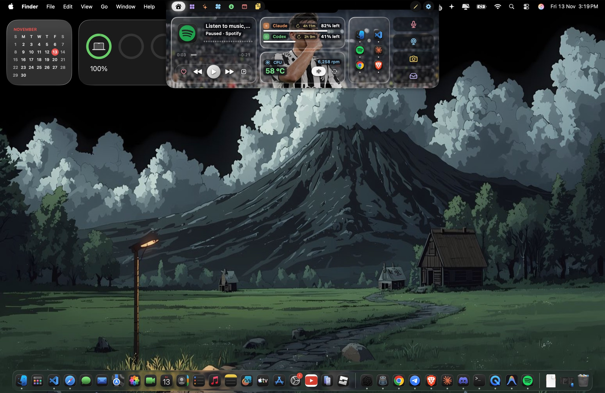
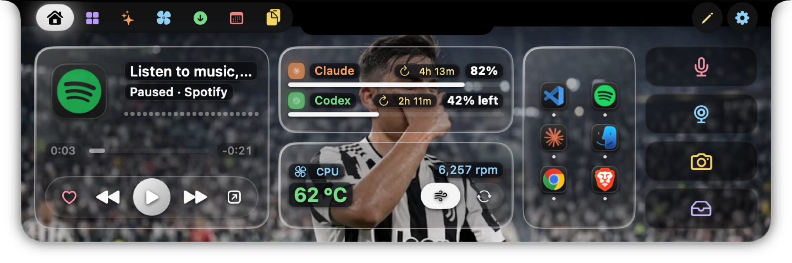
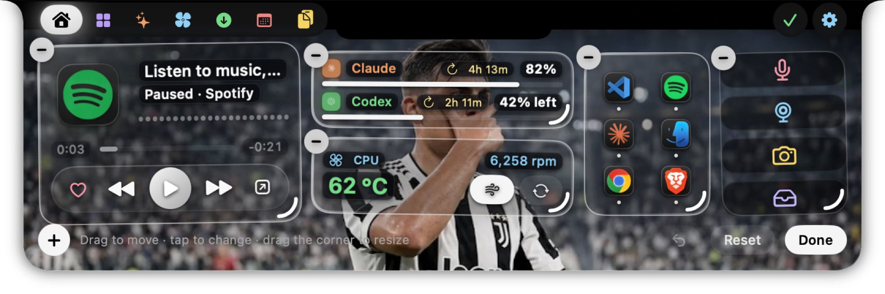
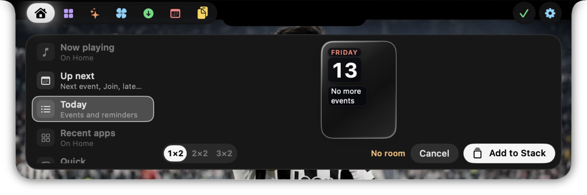
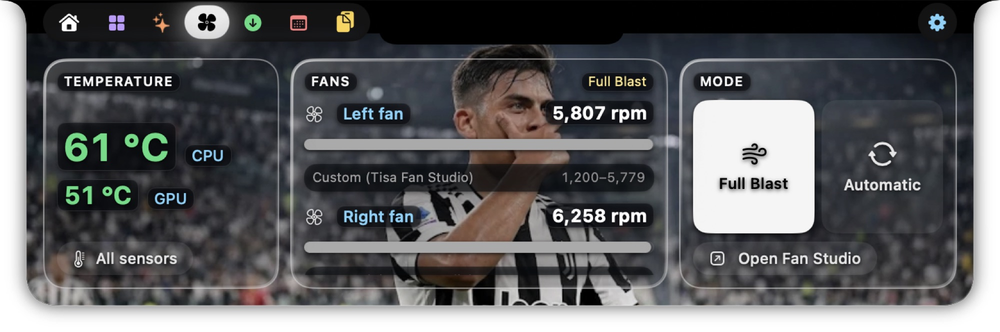
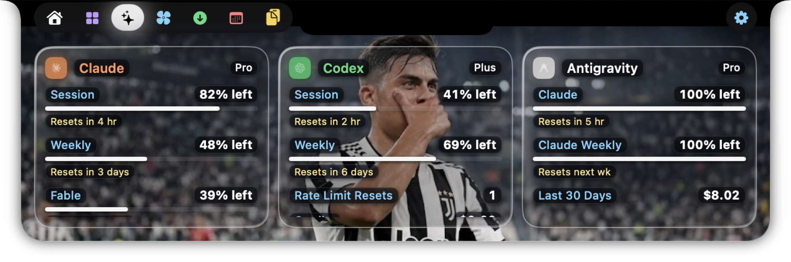
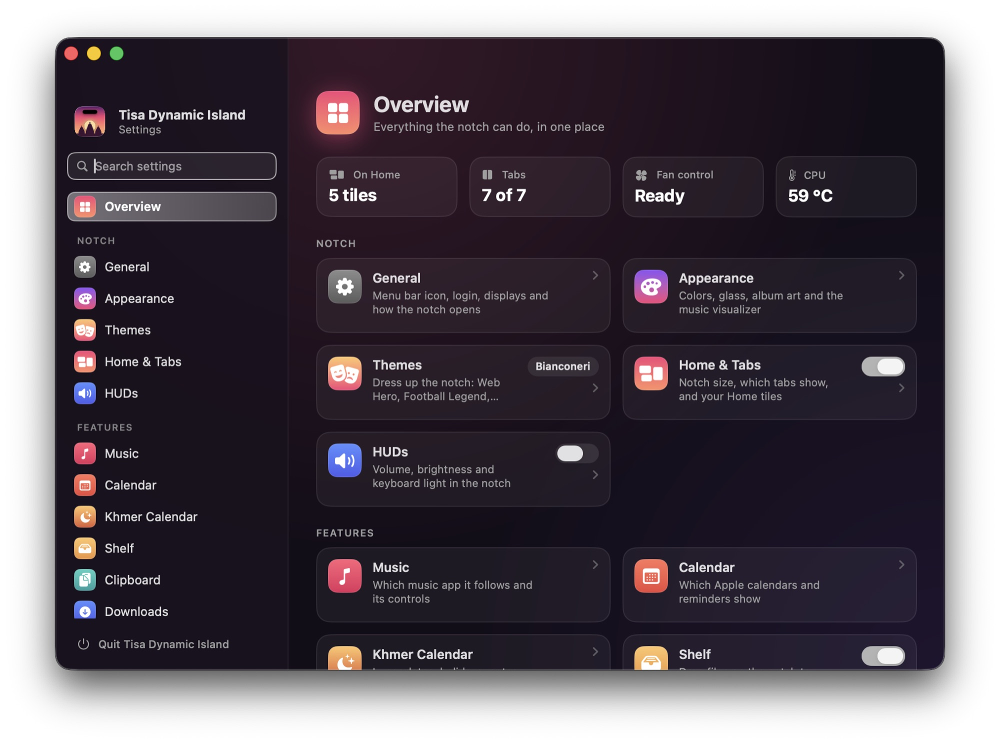
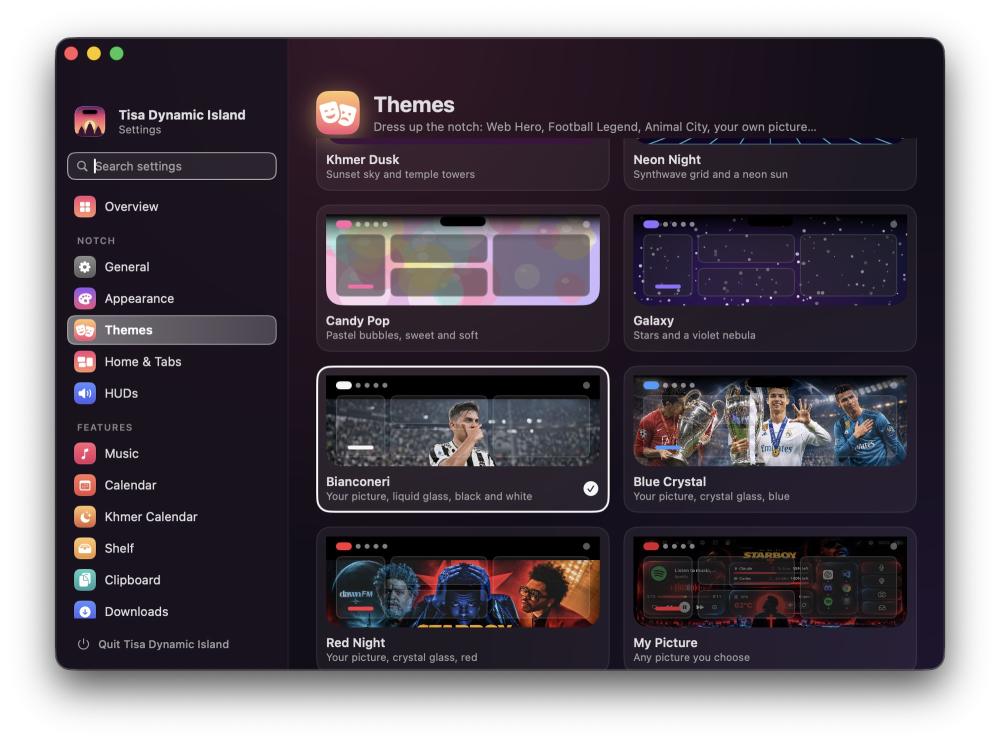

<h1 align="center">Tisa Dynamic Island</h1>

<p align="center">Turns the MacBook notch into a small Dynamic Island: music controls, calendar, file shelf, clipboard history, a Photo Booth and a Khmer postage-stamp booth.</p>

Tisa Dynamic Island is a personal fork of [Boring Notch](https://github.com/TheBoredTeam/boring.notch) by TheBoredTeam, with extra features and a Liquid Glass look.

<p align="center"></p>

## Screenshots

| Home | Edit Home |
| --- | --- |
|  |  |
| **Add a tile** | **Fans** |
|  |  |
| **AI Usage** | **Settings** |
|  |  |
| **Themes** | |
|  | |

## Install on Mac

You need a Mac running **macOS 15 Sequoia or later**. A Mac with a notch looks best, but
any Mac works. There's no ready-made Mac download yet, so you build the app yourself.
It takes about 15 minutes the first time, and you only copy and paste.

> The Windows ZIP doesn't run on a Mac, and GitHub's green **Code → Download ZIP**
> button gives you source code, not an app. Follow the steps below instead.

### Step 1: Get Xcode (one time)

1. Install **Xcode** (free) from the Mac App Store, then open it once and let it finish
   installing its extra parts.
2. In Xcode, go to **Xcode → Settings → Accounts**, click **+**, and sign in with your
   Apple ID. A free Apple ID is fine.
3. Still there, select your Apple ID → **Manage Certificates…** → **+** →
   **Apple Development**. Close the window.

### Step 2: Download and build the app

Open **Terminal** (press ⌘ + Space, type `Terminal`, press Enter), then paste these
lines one at a time and press Enter after each:

```bash
cd ~/Downloads
git clone https://github.com/kuntisa-dev/Tisa.notch.git
cd Tisa.notch
./Scripts/build-release.sh
```

The last command takes a few minutes. When it prints **Built …**, it's done.
If macOS asks to use your keychain, type your Mac password and click **Always Allow**.

### Step 3: Put it in Applications and open it

1. Quit **Boring Notch** or any older copy of Tisa Dynamic Island if one is running.
2. Paste this into Terminal to copy the app into Applications and open it:

   ```bash
   cp -R "build/Build/Products/Release/Tisa Dynamic Island.app" /Applications/
   open "/Applications/Tisa Dynamic Island.app"
   ```

3. Finish the welcome screen. The app now lives at the top of your screen and in the
   menu bar (sparkle icon). It doesn't need a Dock icon.

To start it automatically, open **sparkle icon → Settings → General** and turn on
**Launch at login**.

## Using it

- **Open the notch:** move the pointer onto the notch, or press **⌘ + Shift + I**.
- **Switch tabs:** click the icons along the top-left of the open notch.
  Hover over an icon to see its name.
- **Choose and reorder tabs:** **right-click** the tab bar → **Edit Tabs…**. Drag to
  reorder, **−** to remove, **+** to add. The tab bar fits itself to your notch, so it
  shows a few fewer tabs on a Mac with a wider notch.
- **Edit Home:** on the Home tab, click the pencil button at the top right.
- **Music:** play something in Apple Music, Spotify or another player. The controls
  appear in the notch.
- **Shelf:** drag files onto the notch to keep them handy.
- **Calendar:** pick a day to add notes or routines.
- **Settings:** **sparkle icon → Settings**. Use **Home & Tabs** for tabs and tiles,
  and **Themes** for the look.
- **Quit:** **sparkle icon → Quit**.

Keyboard shortcuts (change them in **Settings → Shortcuts**):

| Action | Shortcut |
| --- | --- |
| Open or close the notch | ⌘ + Shift + I |
| Clipboard history | Control + Option + V |
| Mute or unmute the microphone | Control + Option + M |
| Photo Booth | Control + Option + P |
| Khmer stamp booth | Control + Option + K |

## Fan control (optional)

The **Fans** tab shows temperatures and fan speeds right away. To *change* fan speeds,
do this once:

1. Click the **sparkle icon in the menu bar → Tisa Fan Studio**.
2. Go to **Settings → Fan Control** and click **Copy install command**.
3. Paste it into Terminal and press Enter. Type your Mac password when asked.
   Nothing appears while you type; that's normal.
4. Go back to Fan Studio and click **Reconnect**. The dot turns **green** when it works.

Fan speeds always stay within the range your Mac allows. When the app quits, your fans
go back to normal macOS control. To remove fan control later, click
**Copy removal command** on the same screen and run it in Terminal.

**Dot stays orange?** Fan control only works with the app built by
`build-release.sh` (Step 2) and opened from **Applications**. Copies started from
Xcode's ▶ Run button can't control fans.

## Permissions

macOS asks for each permission the first time you use the feature that needs it.
Click **Allow**:

| Permission | Used for |
| --- | --- |
| Camera | Mirror and Photo Booth |
| Calendars / Reminders | Your events and reminders |
| Notifications | Alerts and routine reminders |
| Automation | Controlling your music app |
| Screen & System Audio Recording | The music visualizer (restart the app after allowing) |

You can change these later in **System Settings → Privacy & Security**.

## Updating

Open Terminal and run:

```bash
cd ~/Downloads/Tisa.notch
git pull
./Scripts/build-release.sh
```

Quit the app, then repeat **Step 3**. Your settings stay. Fan control keeps working
without reinstalling. (Use this repository for updates; the app's **Check for Updates**
menu item points to the original Boring Notch.)

> **Cloned before 13 November 2026?** The repository history was cleaned up, so
> `git pull` will fail. Delete your old **Tisa.notch** folder and start again from Step 2.

## Troubleshooting

- **Nothing appears:** quit other notch apps, open Tisa Dynamic Island again, press
  **⌘ + Shift + I**, and check **Settings → General → Preferred display**.
- **A tab is missing:** turn the feature on in Settings, then add its tab with
  **right-click the tab bar → Edit Tabs…**.
- **`build-release.sh` says "No valid Apple Development certificate":** redo Step 1,
  part 3.
- **`xcodebuild` or `git` not found:** open Xcode once and let it finish installing,
  then run `sudo xcode-select -s /Applications/Xcode.app` in Terminal.
- **macOS blocks the app:** go to **System Settings → Privacy & Security** and click
  **Open Anyway**.

## Uninstall

1. If you set up fan control, run **Copy removal command** from Fan Studio first.
2. Quit the app (**sparkle icon → Quit**).
3. Drag **Tisa Dynamic Island** from **Applications** to the Trash.

### For developers

To run from Xcode instead, open **TisaDynamicIsland.xcodeproj**. Under
**Signing & Capabilities**, pick your own **Team** for **TisaDynamicIsland**,
**TisaDynamicIslandXPCHelper** and **TisaFanHelper**. Then choose the
**TisaDynamicIsland** scheme with **My Mac** and press **⌘R**. Debug builds can't
control fans.

## Download and install on Windows

**Windows 11 x64 desktops and laptops:** [Download Windows v0.3.2](https://github.com/kuntisa-dev/Tisa.notch/releases/tag/windows-v0.3.2).
This is an early development build. Native Windows acceptance testing is still pending,
and it does not yet include every Mac feature.

1. Open the release link and expand **Assets**.
2. Download **TisaDynamicIsland-windows-x64-0.3.2.zip**. Choose the Windows ZIP;
   the automatically generated **Source code** downloads contain source, not the runnable app.
3. Right-click the ZIP in File Explorer → **Extract All**. Keep the entire extracted folder.
4. Open the extracted folder and double-click **TisaDynamicIsland.exe**.
   No Xcode, Visual Studio, .NET SDK or separate .NET runtime installation is required.
5. The island appears near the top of your display. Press **Ctrl + Alt + Space** to open it,
   or use its tray icon. Choose your monitor and layout in **Settings → Desktop & displays**.

To test this development build, quit the app from its tray menu, then double-click
**Test-Windows.cmd** in the same extracted folder. It creates local results on your Desktop
and uploads nothing. See [the full Windows guide](Windows/README.md) for features, updates,
uninstallation and the manual test checklist.

This repository and its release downloads are public. No collaborator invitation is required.

## Features

From Boring Notch:

- Music controls with album art and a visualizer (Apple Music, Spotify, YouTube Music and more)
- Calendar and reminders
- File shelf with AirDrop
- Volume, brightness and keyboard-backlight HUD that replaces the macOS one
- Battery status and a camera mirror

Added in Tisa Dynamic Island (details in [CUSTOM_FEATURES.md](CUSTOM_FEATURES.md)):

- Microphone mute shortcut (⌃⌥M)
- Clipboard history tab (⌃⌥V)
- Download progress for Safari, Chrome-based browsers and Firefox
- Photo Booth tab with 19 live effects (⌃⌥P)
- Khmer stamp booth that turns 3 or 4 photos into a Khmer Heritage postage stamp (⌃⌥K)
- Liquid Glass design for the open notch
- Visualizer that follows the music

## Requirements

**Windows version:** a native Windows 11 port is in early development. See
[Windows build instructions and current status](Windows/README.md). It does not yet match all Mac features.

- macOS 15 Sequoia or later to run the Mac app
- Xcode 26 or later and a macOS version supported by that Xcode release to build
- See [Install and use on Mac](#install-and-use-on-mac) above for the complete steps.

## License and credits

Tisa Dynamic Island is licensed under the GNU General Public License v3.0, the same as Boring Notch. See [LICENSE](LICENSE) and [THIRD_PARTY_LICENSES](THIRD_PARTY_LICENSES).

Based on [Boring Notch](https://github.com/TheBoredTeam/boring.notch) by TheBoredTeam and its contributors. Icon by [@maxtron95](https://github.com/maxtron95). Media control uses [mediaremote-adapter](https://github.com/ungive/mediaremote-adapter), and the shelf started from [NotchDrop](https://github.com/Lakr233/NotchDrop).

## GitHub automation

Builds run with Xcode 26. Code scanning and updater hosting are optional: configure the corresponding GitHub service, then set the repository Actions variable `ENABLE_CODEQL` or `ENABLE_PAGES` to `true` to enable its workflow. Code scanning and Pages availability depend on the repository plan and visibility.
